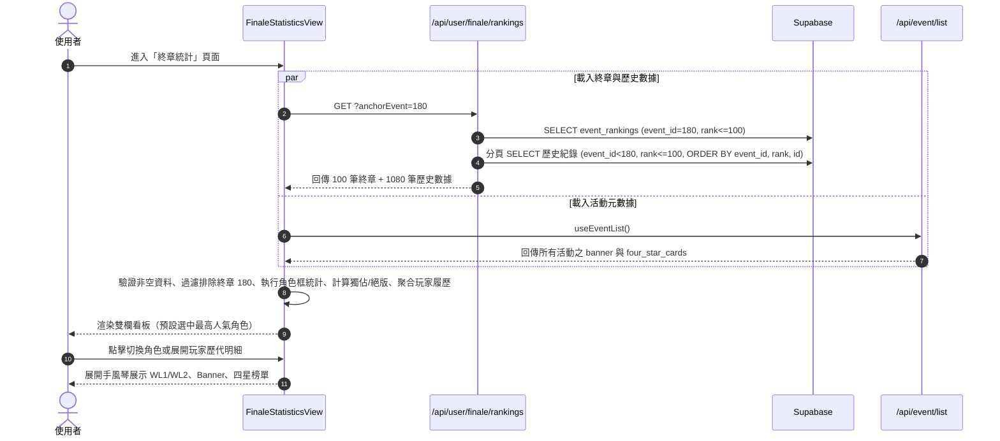

# 📄 頁面規格說明書 - 終章統計 (World Link Finale Statistics)

> **Version**: v1.0.0  
> **Date**: 2026-10-26  

**文件代號**: `PAGE_FINALE_STATISTICS`  
**對應視圖**: `currentView === 'finaleStats'` (`src/App.tsx`)  
**檔案路徑**: `src/components/pages/FinaleStatisticsView.tsx`  
**主要用途**: 呈現 World Link 終章（第 180 期「Wishes in Bloom!」）TOP 100 玩家之角色框分布統計（含獨佔框、絕版框），以及取得者在歷代活動（WL1/WL2 章節、Banner 主打活動、四星角色活動）的 TOP 100 戰績明細。

---

## 1. 功能概述 (Feature Overview)

第 180 期「Wishes in Bloom!」為台服首次 World Link 終章活動（WL2 終章）。終章結算時 TOP 100 玩家獲得之角色獎勵框，代表該玩家於終章期間最常擔任隊長之角色。本頁面旨在透過多維度統計，忠實呈現高階玩家的角色框取向與個人歷史深度。

### 1.1 核心功能
*   **終章角色框分布視覺化**:
    *   **摘要指標卡**: 展示「取得角色 (x / 26)」、「獨佔框數（僅 1 人取得）」與「絕版框數（0 人取得）」。
    *   **頭像矩陣模式 (Avatar Grid)**: 依 6 大團體分列排布。各列前置等大之團體標誌（`w-9 sm:w-10`）與該團體總人數純數字，並以細豎線與右側成員區隔。各格展示角色 Chibi 頭像與取得人數。獨佔角色標注金色「獨佔」外框；絕版角色採用虛線灰色頭像並標注「絕版」標籤（標籤位於頭像上方，預留對齊高度，不覆蓋頭像）。
    *   **長條圖模式 (Bar Chart)**: 26 位角色依取得人數降序排列（同票時依角色 ID 排序），起點以團體代表色細豎線標記所屬團體，桌機版單頁填滿展示 26 列且無垂直捲軸。
*   **取得者名冊與歷代戰績明細 (Player Records Drawer)**:
    *   點選特定角色後，右側即時展示該角色框的所有取得者清單（依終章排名排序，前 10 名金底標記）。
    *   手風琴展開機制（Accordion）：一次僅展開一位玩家，查看其歷史深度：
        1.  **WL 章節 T100 名次表**: 欄位分為 WL1 與 WL2，展示該玩家取得角色與同團其他成員（VS 為 6 人）在該輪章節活動的排名；未進百名者標記為「未進 T100」。
        2.  **Banner 主打活動 T100**: 展示「x / N」累計率，並逐筆列出進榜標籤（如「第68期 · 第4名」）。虛擬歌手（21–26）標記為「不適用」。
        3.  **四星角色活動 T100**: 展示該角色作為四星加成卡時的 TOP 100 進榜率與期數明細。
*   **動態統計範圍摘要 (Statistical Scope Disclosure)**:
    *   頁底收闔卡片展示統計範圍口徑：排除非正式測試期數（#166），一般活動精確收錄第 1–178 期共 166 檔已結束活動；WL2 排除終章 180，精確收錄 6 檔章節活動。
    *   明確宣告各榜僅收錄 TOP 100，文案嚴格使用「第 N 名」、「第 N 期」，杜絕 `#` 符號造成名次與期數混淆。

### 1.2 互動機制
*   **模式切換**: 可在「頭像 (Avatar)」與「長條圖 (Bar Chart)」兩種視覺呈現方式間即時切換。
*   **角色選擇連動**: 點選左側任意角色頭像或長條，右側名單立即切換對應角色，並自動收合前次展開的手風琴。
*   **單一展開保護**: 名冊內每次僅允許展開一名玩家明細，保持版面清爽。
*   **絕版防禦**: 點選絕版角色時穩定呈現空狀態提示，不回彈或重複選取。

---

## 2. 技術實作 (Technical Implementation)

### 2.1 資料架構與獲取流程
位於 `src/components/pages/FinaleStatisticsView.tsx` 與 `api/user/[id]/rankings.ts`。

*   **共用常數定義 (`FINALE_EVENT_ID`)**:
    *   終章期數定義於 `src/config/constants.ts` 之 `FINALE_EVENT_ID = 180`，前後端共用唯一常數來源。
*   **後端多人排名 API (`/api/user/finale/rankings?anchorEvent=180`)**:
    *   擴充既有 `api/user/[id]/rankings.ts`，當 `id === 'finale'` 時切入多人錨點模式。
    *   嚴格驗證 `anchorEvent === String(FINALE_EVENT_ID)`，不合法即回傳 400 且不查 DB。
    *   查詢 Supabase `event_rankings` 表中 `event_id = 180 AND chapter_char_id = 0 AND rank <= 100`，取得終章 100 位玩家名冊與隊長卡資訊（`raw_user_card`）。
    *   分頁擷取該 100 位玩家在 `event_id < 180 AND rank <= 100` 的歷史名次記錄。
    *   **唯一性排序保證**: 採用 `.order('event_id').order('rank').order('id')` 消除章節同分跨頁斷層，保證剛好 1,080 筆且無重複。
    *   API 設定 24 小時 CDN 快取 (`public, s-maxage=86400, stale-while-revalidate=3600`)。
*   **前端空資料防禦**:
    *   若 API 備援觸發或終章名單為空，前端阻斷渲染並顯示「無法取得終章排名數據。」，防止 26 角色誤判為絕版。
*   **活動元數據獲取 (`useEventList`)**:
    *   透過 `/api/event/list` 取得 Supabase `events` 表的活動屬性（`banner`、`four_star_cards`、`start_at`、`closed_at`）。
*   **動態 WL 結構解析 (`ConfigContext`)**:
    *   透過 `getWlIdsByRound(1)` 與 `getWlIdsByRound(2)` 動態推導各團章節，並主動過濾 `FINALE_EVENT_ID`，確保 WL2 僅納入第 163、167、170、171、176、179 期共 6 期章節活動。
*   **角色 ID 轉譯 (`getCharacterIdByCardId`)**:
    *   透過 `raw_user_card[0]`（卡片 ID），經由 `cardService.ts` 動態換算為角色 ID（1–26）。

### 2.2 資料口徑與計算模型

| 統計項目 | 計算邏輯與邊界處理 |
|---|---|
| **取得角色** | 玩家於 #180 之 `raw_user_card[0]` 所屬角色 ID。 |
| **同團成員映射** | Leo/need (1–4)、MMJ (5–8)、VBS (9–12)、WxS (13–16)、25時 (17–20)、VS (21–26)。展開表以取得角色為首列高亮，其餘成員依序排列。 |
| **WL 章節範圍** | WL1 為 6 期（112, 118, 124, 130, 137, 140）；WL2 為 6 期（163, 167, 170, 171, 176, 179），終章 180 予以安全排除。 |
| **Banner 總期數** | 第 1–178 期中，`banner == charId` 且非 WL 活動的總數。虛擬歌手（21–26）總期數為 0，顯示「不適用」。 |
| **四星卡總期數** | 第 1–178 期中，`four_star_cards` 包含該角色（前綴比對 `split('-')[0]`）且非 WL 活動的總數。 |
| **一般活動期數** | 總期數為 166 期（第 1–178 期扣除 11 檔 WL 活動與 1 檔測試活動 #166）。 |

---

## 3. UI/UX 排版設計 (UI Layout)

### 3.1 容器與響應式佈局規格
*   **全域容器規格**:
    *   採用 `w-full py-4 animate-fadeIn`，不額外限制最大寬度或加疊左右 padding，與 `WorldLinkView` 等觀測站既有頁面邊界 100% 齊平。
*   **桌面端單頁無捲動視野 (`lg` 以上，1280×800)**:
    *   左右比例分配為 5:7（`grid grid-cols-12 gap-4`）。
    *   網格高度設定為 `lg:h-[calc(100vh-185px)] lg:min-h-[520px]`，充分利用垂直視野空間，扣除 App 外框 padding、標題區與底部收合區高度後，在 1280×800 解析度下 **整頁 document 完全無垂直捲動條**。
    *   左側「角色框分布」卡片採緊湊佈局：
        *   頭像模式：提升頭像尺寸至 `w-9 sm:w-10`，數字加強為 `text-base font-black`，前置等大團體標誌與團體總人數純數字，中置細豎線分割團體與角色區塊，6 團排布完全貼合高度，無需內部捲軸。
        *   長條圖模式：以 `h-full grid gap-px` 均分 26 角色高度，移除強制最小高度，徹底杜絕多餘捲軸。
    *   右側「取得者名冊」內部獨立滾動（`overflow-y-auto scroll-thin`），展開名冊不影響全頁垂直佈局。
*   **行動端適配 (`lg` 以下，375px)**:
    *   自動轉為垂直流式佈局（`grid-cols-1`）。
    *   上方為分布統計，下方為玩家名冊，名冊預設不自動展開手風琴。
    *   徹底杜絕橫向捲動。

### 3.2 視覺元件與互動狀態
*   **選單與導覽圖示**:
    *   導覽列採用白石杏應援色 (`#00BBDD`)。
    *   選單與首頁卡片圖示統一採用「榮譽獎章（圓形框 + 垂掛彩帶）」向量線條圖標（24×24 viewBox、stroke 風格），與一般長條圖示形成鮮明識別區隔。
*   **預設選中狀態**:
    *   初始化完成後預設選中取得人數最多之角色（曉山瑞希，12 人）。
    *   預設啟用「頭像矩陣模式」。
*   **絕版角色點選反饋**:
    *   若點選取得人數為 0 之絕版角色（望月穗波、日野森志步、日野森雫、MEIKO），右側名冊切換為灰階空狀態：「本屆無玩家取得此角色框」。
*   **標籤與高亮規範**:
    *   獨佔角色框以金色外框與「獨佔」標籤高亮標記。
    *   前 10 名名次標籤以琥珀色底標記 (`bg-amber-400 text-amber-950`)。
    *   分數數值以 `text-cyan-600 dark:text-cyan-400 font-bold font-mono` 呈現。

---

## 4. 模組依賴 (Module Dependencies)

```mermaid
graph TD
    FinaleStatisticsView[FinaleStatisticsView.tsx] --> ConfigContext[ConfigContext.tsx]
    FinaleStatisticsView --> useEventList[hooks/useEventList.ts]
    FinaleStatisticsView --> cardService[services/cardService.ts]
    FinaleStatisticsView --> gameUtils[utils/gameUtils.ts]
    FinaleStatisticsView --> constants[config/constants.ts (FINALE_EVENT_ID)]
    FinaleStatisticsView --> apiEndpoint[/api/user/finale/rankings]
    apiEndpoint --> Supabase[(Supabase events & event_rankings)]
```

*   **內部組件與 Hooks**:
    *   `src/contexts/ConfigContext.tsx`：提供 `getWlIdsByRound`、`getWlDetail` 與 `isWorldLink`。
    *   `src/hooks/useEventList.ts`：提供活動列表與 DB 企劃屬性。
    *   `src/services/cardService.ts`：提供卡片至角色之反查轉換。
    *   `src/utils/gameUtils.ts`：提供 `getAssetUrl` 等圖片視覺路徑。
    *   `src/config/constants.ts`：導出 `FINALE_EVENT_ID`，並提供 `CHARACTERS`、`UNITS`。

---

## 5. 序列圖 (Sequence Diagram)


